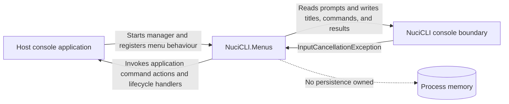
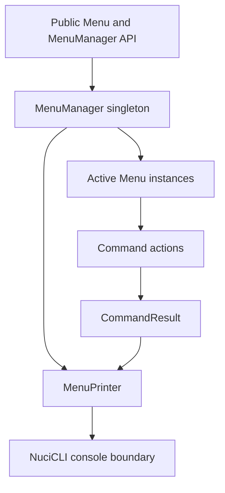
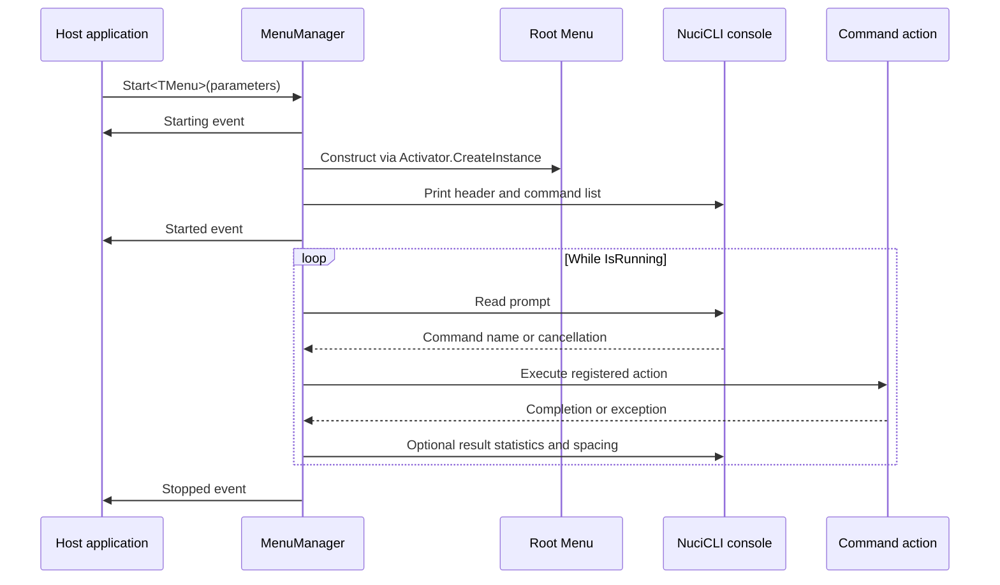
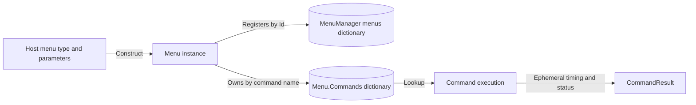
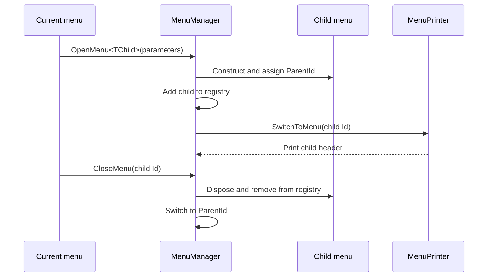
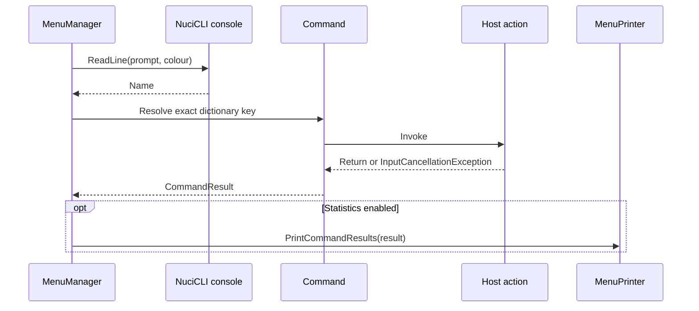
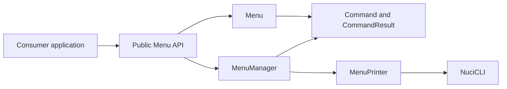

# NuciCLI.Menus Architecture

This document describes the current architecture of the `NuciCLI.Menus` .NET library and its unit-test boundary. It covers interactive menu orchestration, command execution, console presentation, and lifecycle ownership; it does not define the architecture of applications that consume the package.

## 📑 Table of Contents

- [Purpose](#purpose)
- [System Context](#system-context)
- [Architectural Style](#architectural-style)
- [Runtime Flow](#runtime-flow)
- [Components](#components)
- [Data Architecture](#data-architecture)
- [Interfaces and Integrations](#interfaces-and-integrations)
- [Key Flows](#key-flows)
  - [Menu Navigation](#menu-navigation)
  - [Command Execution](#command-execution)
- [Cross-Cutting Concerns](#cross-cutting-concerns)
  - [Error Handling](#error-handling)
  - [Concurrency and Resource Use](#concurrency-and-resource-use)
- [Dependency Direction and Rules](#dependency-direction-and-rules)
- [External Dependencies](#external-dependencies)
- [Deployment and Operations](#deployment-and-operations)
- [Compatibility Contracts](#compatibility-contracts)
- [Testing and Verification](#testing-and-verification)
- [Design Constraints](#design-constraints)
- [Extension Points](#extension-points)
  - [Custom Menus](#custom-menus)
  - [Commands](#commands)
- [Source Map](#source-map)
- [Related Documentation](#related-documentation)

## 🎯 Purpose

`NuciCLI.Menus` provides a lightweight, command-driven menu system for interactive console applications built on `NuciCLI`. This document records the implemented boundaries and runtime contracts for package maintainers and consumers, including menu ownership, command dispatch, console output, dependencies, and verification.

## 🌐 System Context

The library runs inside a host console application. The host creates a root `Menu` through `MenuManager`, supplies menu subclasses and command actions, and receives lifecycle events. `NuciCLI` is the console boundary for input, output, colours, and input cancellation. The package owns transient menu and command state; it does not own a database, filesystem store, network service, authentication boundary, or deployment host.



The principal external boundaries are:
- **Host application:** Owns the process, concrete `Menu` subclasses, command actions, and application state; calls the public manager and menu APIs.
- **NuciCLI console boundary:** Supplies console input/output, colours, and input cancellation behaviour used by the manager and printer.
- **Process memory:** Holds the manager's menu registry and each menu's command dictionary for the duration of their lifetimes; no durable store is used.

## 🏗️ Architectural Style

The implementation is a small in-process library using an event-driven facade, hierarchical object composition, and a synchronous command loop. `MenuManager` orchestrates menu instances and lifecycle events, `Menu` owns commands and menu presentation settings, and internal collaborators execute commands and format output. The design keeps menu state in memory and makes command actions the host application's extension boundary.



The principal architecture boundaries are:
- **Public menu boundary:** `Menu` exposes menu identity, hierarchy, presentation settings, commands, and disposal; concrete menu subclasses belong to the host.
- **Orchestration boundary:** `MenuManager` owns the active menu, menu registry, parent-child transitions, synchronous read/dispatch loop, and lifecycle events.
- **Execution boundary:** `Command` invokes an `Action`; `CommandResult` represents timing and cancellation status; unexpected exceptions propagate.
- **Presentation boundary:** `MenuPrinter` translates menu and command state into `NuciConsole` output.

## 🔄 Runtime Flow



The principal runtime sequence is:
1. The host calls `Start<TMenu>`; `Starting` is raised before menu construction.
2. The manager constructs and registers the root menu, marks itself running, prints the active menu, and raises `Started`.
3. The manager synchronously reads a command, resolves it in the active menu dictionary, executes its action, and optionally prints statistics.
4. `exit` closes the active menu; a child returns to its parent, while the root sets `IsRunning` to `false` and raises `Stopped` after the loop ends.

## 🧩 Components

| Component | Responsibility | Principal Dependencies | Lifetime or Ownership |
|-----------|----------------|------------------------|-----------------------|
| `MenuManager` | Singleton access, menu registry, hierarchy, lifecycle, input loop, and dispatch | `Menu`, `MenuPrinter`, `NuciConsole` | Process-level singleton when accessed through `Instance`; menu registry owns active instances |
| `Menu` | Menu identity, parent link, presentation settings, built-in commands, custom command registration, and disposal | `Command`, `MenuManager`, `MenuPrinter` | Created by the manager or host; disposed by the manager when closed |
| `Command` | Stores a name, description, and `Action`; captures execution timing and cancellation | Host `Action`, `InputCancellationException` | Owned by its `Menu`; cleared on menu disposal |
| `CommandResult` | Represents duration, exception, and derived success/failure/cancelled status | `CommandStatus` | Created per command execution; consumed by optional presentation |
| `MenuPrinter` | Formats menu headers, command lists, and execution statistics | `NuciConsole`, `NuciExtensions` | Stateless internal helper |

## 💾 Data Architecture

The package owns transient object state only. Menu instances are stored by generated or assigned identifier in the manager's in-memory dictionary; each menu stores commands by exact, case-sensitive name. Opening a child assigns its parent identifier, and closing removes and disposes the menu. No persistence, cache, migration, or cross-process consistency mechanism exists.



| Data or Store | Owner | Representation and Storage | Lifecycle or Consistency |
|---------------|-------|----------------------------|--------------------------|
| Menu registry | `MenuManager` | In-memory `Dictionary<string, Menu>` keyed by menu `Id` | Created on open, removed before disposal on close; process-local |
| Command registry | `Menu` | In-memory `Dictionary<string, Command>` keyed by exact command name | Built with the menu, rejects duplicate keys, cleared during disposal |
| Command result | `Command` / `MenuManager` | In-memory `CommandResult` containing timestamps and optional exception | Created for one execution and discarded after optional printing |

## 🔌 Interfaces and Integrations

| Interface or Integration | Direction | Contract | Owner | Failure Semantics |
|--------------------------|-----------|----------|-------|-------------------|
| `Menu` public API | Inbound | Consumers subclass `Menu`, configure properties, register `Action` commands, and call `Exit` | `Menu` | Duplicate command names raise `ArgumentException`; disposal is idempotent |
| `MenuManager` public API | Inbound | `Start`, `OpenMenu`, `CloseMenu`, `SwitchToMenu`, state properties, and lifecycle events | `MenuManager` | Reflection construction failures and invalid identifiers propagate as exceptions |
| `NuciConsole` | Bidirectional | Prompt input, coloured output, newline output, cursor adjustment, and cancellation exception | `MenuManager` and `MenuPrinter` | Input cancellation is handled at the read boundary; output failures are not translated |
| Host command actions | Outbound from library | Synchronous `Action` delegates registered through `Menu.AddCommand` | Host application | `InputCancellationException` becomes `Cancelled`; other exceptions propagate from execution |

## 🔀 Key Flows

### Menu Navigation



Opening a menu while another menu is active creates a parent-child relation. Closing a child disposes it and restores the parent; closing a root menu stops the manager loop. The manager owns transitions and the registry, while each menu owns its commands and disposal event.

### Command Execution



Commands are resolved by exact name and executed synchronously. Unknown names produce a red `Unknown command` message without execution. The result printer is optional; failed command exceptions are not caught by `Command.Execute` and therefore escape the loop.

## 🧵 Cross-Cutting Concerns

### Error Handling

Menu construction, invalid menu identifiers, duplicate command registration, and unexpected command exceptions are allowed to propagate to the host. `InputCancellationException` during input causes the manager to adjust the cursor and continue; the same exception during a command is represented as `CommandStatus.Cancelled`. Other command exceptions are rethrown. No retry, persistence, or fallback policy is implemented.

### Concurrency and Resource Use

The `MenuManager.Instance` accessor uses a lock for lazy singleton initialisation. Menu operation and command execution are otherwise synchronous and use mutable in-memory dictionaries; the API does not provide concurrent menu mutation or parallel command execution guarantees. `Menu` disposal clears commands and raises `Disposed` once for explicit disposal, and manager-owned menus are disposed when closed.

## 🧭 Dependency Direction and Rules

The public orchestration API depends on menu state and internal presentation/execution helpers. Concrete application menus and actions depend on the package API, not the reverse. Console interaction is isolated behind the `NuciConsole` calls used by the manager and printer.



The principal dependency rules are:
- Consumer code supplies menu subclasses and command actions through public APIs.
- `MenuManager` owns menu registration, active-menu transitions, and manager lifecycle; consumers do not manipulate its internal registry.
- Presentation remains in `MenuPrinter`; menu orchestration does not duplicate command-list formatting.
- The package does not depend on consumer application state, persistence, or remote services.

## 📦 External Dependencies

| Dependency | Responsibility | Integration Boundary | Architectural Consequence |
|------------|----------------|----------------------|---------------------------|
| `NuciCLI` 3.0.1 | Console input, output, colours, and input cancellation | `MenuManager` and `MenuPrinter` | Console behaviour and cancellation semantics follow the NuciCLI contract |
| `NuciExtensions` 5.3.1 | String reversal used by title presentation | `MenuPrinter` | Title rendering depends on the extension package's `Reverse` behaviour |
| .NET 10.0 | Runtime, reflection, collections, events, disposal, and timing | All library components | Package targets the .NET 10.0 runtime |

## 🚀 Deployment and Operations

`NuciCLI.Menus` is a NuGet library loaded into a consumer console process; it is not an independently hosted service. Runtime state is process-local and non-persistent. The consumer owns process startup, shutdown, console availability, command-action resources, and any application-level recovery or scaling concerns.

| Concern | Current Design | Architectural Consequence |
|---------|----------------|---------------------------|
| Process topology | In-process library inside one console application | No independent service deployment or network endpoint exists |
| State | Menu hierarchy and command registrations live in memory | State is lost when the host process exits |
| Scaling | One synchronous manager loop per manager instance | Throughput and responsiveness depend on host command actions |
| Shutdown | Root menu closure ends the loop and raises `Stopped` | Consumers must release resources owned by command actions and the host |

## 🛡️ Compatibility Contracts

| Contract | Owner | Invariant | Verification | Change Policy |
|----------|-------|-----------|--------------|---------------|
| Built-in commands | `Menu` | Every constructed menu registers exact `exit` and `help` names | `MenuCommandRegistrationTests` | Preserve names and their navigation/help semantics |
| Menu hierarchy lifecycle | `MenuManager` | Child `exit` returns to `ParentId`; root `exit` stops the loop | `MenuManagerLifecycleTests` and manager tests | Preserve parent assignment, disposal, and event ordering |
| Command names | `Menu` | Names are exact and case-sensitive dictionary keys; duplicates are rejected | `MenuCommandRegistrationTests` | Do not change lookup or duplicate semantics without a compatibility plan |
| Lifecycle events | `MenuManager` and `Menu` | Startup and disposal events occur at their implemented lifecycle boundaries | Lifecycle and menu tests | Preserve event timing and idempotent disposal behaviour |
| Package target and public signatures | Project and public types | Package targets `net10.0`; public menu and manager methods remain callable as documented | `dotnet build` and `dotnet test` | Treat signature or target changes as a breaking change |

## ✅ Testing and Verification

The unit-test project verifies menu defaults and disposal, command registration boundaries, manager state validation, and startup event ordering. Tests use NUnit and Moq and reference the library project directly. Console rendering and a full interactive input loop are not exercised by the current test suite.

Execute the principal automated verification with:

```bash
dotnet test NuciCLI.Menus.slnx
```

## ⚠️ Design Constraints

- **Synchronous interaction:** Command actions run on the manager's input loop, so long-running actions block further input.
- **Process-local state:** Menu instances, registrations, and command results are not persisted or shared between processes.
- **Reflection construction:** `OpenMenu` requires a compatible constructor and propagates construction failures.
- **Consumer-owned actions:** Command actions are arbitrary host delegates; their state, exceptions, and resource usage are outside the package's ownership.
- **Console coupling:** Interactive behaviour depends on the `NuciCLI` console contract rather than an abstract input/output interface.

## 🔧 Extension Points

### Custom Menus

1. Derive a concrete class from `Menu`.
2. Register commands in its constructor and configure its title, prompt, and colours.
3. Open it through `MenuManager.OpenMenu<TMenu>` or use it as the `Start<TMenu>` root.

The constructor must be discoverable by the manager's `Activator.CreateInstance` call and must preserve menu disposal and parent-navigation behaviour.

### Commands

1. Call `Menu.AddCommand` with an exact name, description, and synchronous `Action`.
2. Keep command actions responsible for host application behaviour and use the manager API for menu navigation.
3. Add tests for action registration, duplicate names, and any lifecycle interaction.

Command names are case-sensitive and must not collide with the built-in `exit` and `help` commands.

## 🗺️ Source Map

| Area | Path |
|------|------|
| Public menu and command orchestration | `NuciCLI.Menus/Menu.cs`, `NuciCLI.Menus/MenuManager.cs`, `NuciCLI.Menus/Command.cs` |
| Results and presentation | `NuciCLI.Menus/CommandResults.cs`, `NuciCLI.Menus/CommandStatus.cs`, `NuciCLI.Menus/MenuPrinter.cs` |
| Unit tests | `NuciCLI.Menus.UnitTests/` |
| Package and solution manifests | `NuciCLI.Menus/NuciCLI.Menus.csproj`, `NuciCLI.Menus.UnitTests/NuciCLI.Menus.UnitTests.csproj`, `NuciCLI.Menus.slnx` |
| Continuous integration | `.github/workflows/dotnet.yml` |

## 📚 Related Documentation

- [`README.md`](README.md) documents installation, usage, public API examples, and user-facing menu behaviour; this document records the architectural boundaries and implementation ownership.
