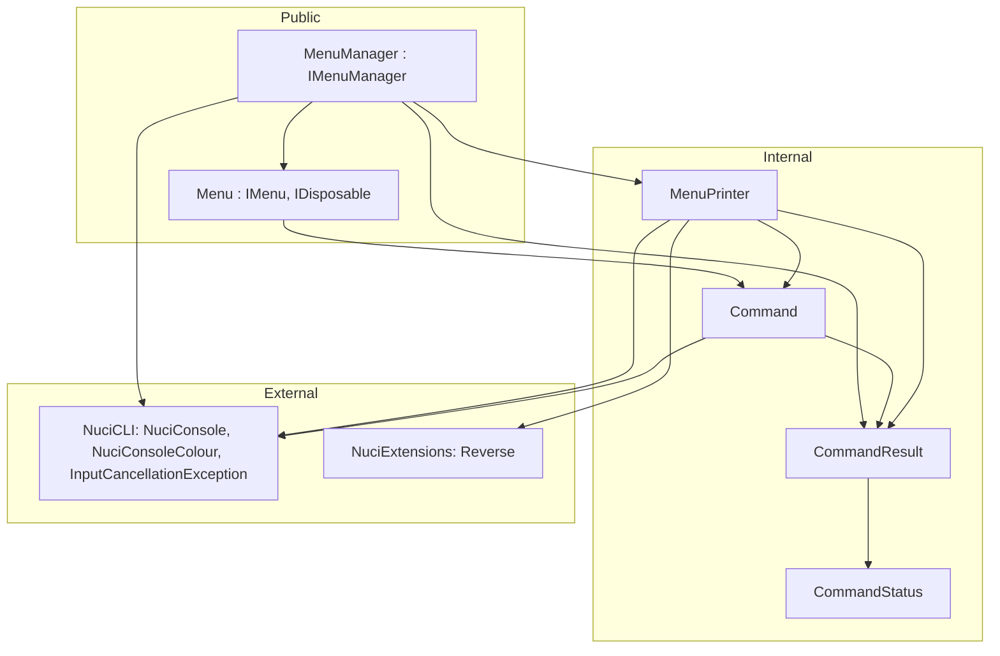
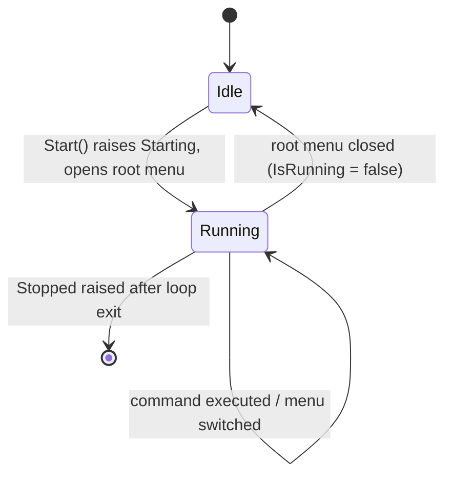

# Architecture

The root [`ARCHITECTURE.md`](../ARCHITECTURE.md) is the canonical architecture description and is not reproduced here. This document elaborates on the implementation-level layering that the root document summarises.

## Layering

Verified facts about the layering:

- `Command` references `NuciCLI.InputCancellationException` directly in its `catch` filter (`Command.cs`), so even the execution layer is coupled to the NuciCLI exception type.
- `MenuPrinter` is the only consumer of `NuciExtensions.Reverse`.
- `MenuManager` is the only type that writes the "Unknown command" message and that reads input.
- `Menu` never calls `MenuPrinter` directly except through the `help` handler (`HandleHelp`).

## Interface usage

`IMenu` and `IMenuManager` are `internal`. They exist as member contracts and for architecture-test visibility, not as consumer extension points. `Menu` and `MenuManager` are declared with the interface in their base list, but consumers always reference the concrete types because the interfaces are not exported.

Consequences:

- Adding a member to `IMenu` or `IMenuManager` forces a matching implementation change and cannot break consumers.
- Consumers cannot substitute their own menu manager implementation.

## State topology

`IsRunning` is set `true` after `OpenMenu` and cleared only by `CloseMenu` when the closed menu has no `ParentId`. There is no re-entrancy guard: calling `Start<TMenu>` again after a completed run reuses the same manager instance and its residual registry.

## Ownership and disposal

| Object | Created by | Disposed by | Effect of disposal |
|--------|-----------|-------------|--------------------|
| Root menu | `MenuManager.Start` via `OpenMenu` | `CloseMenu` on exit | Removed from `menus`, commands cleared, `Disposed` raised |
| Child menu | `MenuManager.OpenMenu` | `CloseMenu` | Same, then `SwitchToMenu(parentId)` |
| `Command` | `Menu.AddCommand` | `Menu.Dispose` (dictionary clear) | No explicit disposal; delegates are released with the dictionary |
| `CommandResult` | `Command.Execute` | Not disposed (no unmanaged state) | Eligible for GC after statistics printing |

`Menu` implements the full dispose pattern with a finaliser (`~Menu() => Dispose(false)`). The finaliser path returns immediately because `Dispose(bool)` short-circuits when `disposing` is `false`, so `IsDisposed` is never set and `Disposed` never raised from the finaliser.

## Cross-cutting implementation notes

- **No dependency injection.** All collaborators are concrete and instantiated internally; the console is reached through static members.
- **No configuration source.** Behaviour is changed through public properties (`AreStatisticsEnabled`, menu properties) at runtime.
- **No logging.** Observable behaviour is console text only.
- **No async.** Every public member is synchronous; `Start` blocks until the loop ends.

See [`components/`](./components/) for per-type detail and [`flows/`](./flows/) for call sequences.