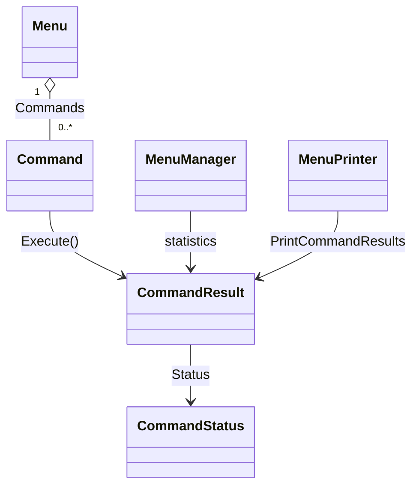

# Component: command execution (`Command`, `CommandResult`, `CommandStatus`)

Source: `NuciCLI.Menus/Command.cs`, `NuciCLI.Menus/CommandResult.cs`, `NuciCLI.Menus/CommandStatus.cs`.

## `NuciCLI.Menus.Command`

```csharp
internal sealed class Command(string name, string description, Action action)
```

C# 12 primary constructor; the three properties are `get`-only and captured from the parameters.

| Member | Type | Notes |
|--------|------|-------|
| `Name` | `string` | Dictionary key in `Menu.Commands`. |
| `Description` | `string` | Printed by `MenuPrinter.PrintCommandList`. |
| `Execute()` | `CommandResult` | Measures wall-clock time and captures cancellation. |

### `Execute()` semantics

```csharp
DateTime startTime = DateTime.Now;
try
{
    action();
    return new CommandResult(startTime, DateTime.Now);
}
catch (InputCancellationException ex)
{
    return new CommandResult(startTime, DateTime.Now, ex);
}
```

Verified properties:

1. **Timing source** is `DateTime.Now` (local time, low resolution relative to `Stopwatch`). Durations are therefore subject to clock adjustments.
2. **Only `InputCancellationException` is caught.** Every other exception escapes `Execute()` and hence `MenuManager.TakeCommand`.
3. Because non-cancellation exceptions escape, `CommandStatus.Failure` is unreachable in the current implementation — nothing constructs a `CommandResult` with a non-cancellation exception. `MenuPrinter.PrintCommandResults` nevertheless implements the failure branch.
4. A `null` action (permitted by `Menu.AddCommand`) throws `NullReferenceException` here, which escapes.
5. Execution is fully synchronous on the caller's thread; there is no timeout, retry, or cancellation token.

## `NuciCLI.Menus.CommandResult`

```csharp
internal sealed class CommandResult(DateTime startTime, DateTime endTime)
{
    public DateTime StartTime { get; }
    public DateTime EndTime { get; }
    public TimeSpan Duration => EndTime - StartTime;
    public Exception? Exception { get; }
    public CommandStatus Status { get; }
}
```

| Member | Derivation |
|--------|------------|
| `Duration` | `EndTime - StartTime`. |
| `Exception` | `null` in the success constructor; the captured exception in the three-argument constructor (`Exception` is a `{ get; }` auto-property assigned in that overload's body). |
| `Status` | `null` ⇒ `Success`; `InputCancellationException` ⇒ `Cancelled`; otherwise ⇒ `Failure`. |

The `Exception` property has no initialiser, so the two-argument constructor leaves it `null`. This is an internal type with no nullable-analysis warning because the property type is `Exception?`.

## `NuciCLI.Menus.CommandStatus`

```csharp
internal enum CommandStatus { Success, Failure, Cancelled }
```

Default value (0) is `Success`. Only `Success` and `Cancelled` are reachable through current code paths; `Failure` exists for the printer's red branch and for future exception propagation.

## Rendering contract

`MenuPrinter.PrintCommandResults` consumes a `CommandResult` and prints:

```
Command finished with status <Success|Failed|Cancelled> after <duration>
```

plus, for `Failure`, `Error message: <Exception.Message>` in red. Duration formatting lives in `MenuPrinter.GetHumanFriendlyDurationString`: below one minute it prints seconds with two decimals (`0.00s`), otherwise minutes with two decimals (`0.00m`). Hours are therefore rendered as large minute values.

## Relationships

