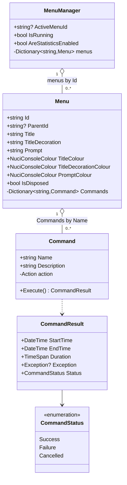

# Data model

The library owns no persistent data. All models are transient in-memory objects.

## Entities

## Fields, keys, and constraints

| Store | Key | Value | Cardinality | Key constraint |
|-------|-----|-------|-------------|----------------|
| `MenuManager.menus` | `menu.Id` (GUID string by default) | `Menu` | unbounded while menus are opened | Keys are auto-generated; a consumer-assigned duplicate `Id` causes `ArgumentException` from `Dictionary.Add` |
| `Menu.Commands` | `command.Name` | `Command` | at least 2 (`exit`, `help`) until disposal | Exact, case-sensitive; duplicates rejected |

## Relationship semantics

- **Parent link** is a single nullable string on the child, not a collection on the parent. There is no child registry on `Menu`; `MenuManager.menus` is the only place to discover relationships, and it requires scanning for `ParentId` values.
- **No sibling ordering**, no explicit depth field, no cycle protection at the model level. A cycle can only arise if a consumer assigns `ParentId` values manually.
- **Deleting a parent** does not update its children. Children of a closed menu keep a `ParentId` pointing at a removed id; closing such a child throws `KeyNotFoundException` during the parent switch.

## Value semantics

| Field | Value semantics |
|-------|-----------------|
| `Id` | Settable `string`; equality is ordinal (dictionary key). |
| `Title`, `TitleDecoration`, `Prompt`, command `Name`/`Description` | Mutable `string`; rendered directly, no escaping or formatting. |
| Colours | `NuciConsoleColour` values from NuciCLI (`Green`, `Yellow`, `White` defaults). |
| Times | `DateTime.Now` (local); `Duration` is a computed `TimeSpan`. |
| `IsDisposed` | Monotonic `false → true`; never reset. |

## Serialisation

None. No type carries serialisation attributes, and nothing is written to disk, network, or logs. `CommandResult` exists only in memory and is discarded after the optional statistics print.

## Persistence

See [`state-and-persistence.md`](./state-and-persistence.md). There is no persistence layer, migration, or schema.