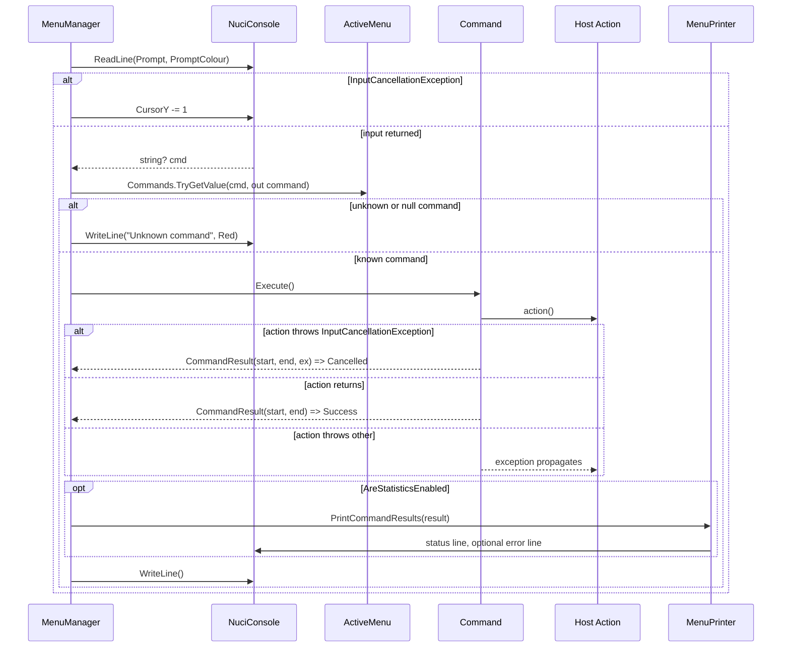

# Flow: command dispatch

Source: `MenuManager.TakeCommand`, `Command.Execute`, `MenuPrinter.PrintCommandResults`.

## Sequence

## Decision table

| Input / outcome | Console output | Manager state | Loop continues |
|-----------------|----------------|---------------|----------------|
| `ReadLine` throws `InputCancellationException` | cursor row decremented by 1 (no message) | unchanged | yes |
| Name not found in `ActiveMenu.Commands` | `Unknown command` in red | unchanged | yes |
| Registered command returns normally | blank line; optional success statistics | unchanged | yes |
| Command action throws `InputCancellationException` | blank line; optional `Cancelled` statistics | unchanged | yes |
| Command action throws anything else | none from the manager (statistics not printed; trailing newline skipped) | unchanged | **no** — exception escapes `Start` |
| `cmd` is `null` | none | unchanged | **no** — `ArgumentNullException` from `Dictionary.TryGetValue` |
| Command closes the active menu (e.g. `exit`) | header of parent, or nothing if root | registry/active id updated; `IsRunning` may become false | yes (loop re-evaluates) |
| Command opens a child menu | blank line, then child header | registry/active id updated | yes |

## Ordering guarantees

1. Statistics are printed **after** the action completes and **before** the trailing blank line. A command that itself writes output therefore precedes the statistics block.
2. `exit` executes through `Menu.Exit` → `MenuManager.Instance.CloseMenu(Id)`. Because it resolves the **static singleton**, a menu created by a non-singleton manager instance (as in unit tests) will be closed on the wrong registry. Inside a normal host there is one manager, so the behaviour is correct.
3. After `exit` on a child, the parent's header is printed during dispatch (inside `CloseMenu` → `SwitchToMenu`). The trailing `WriteLine()` from `TakeCommand` then adds a blank line before the next prompt.
4. After `exit` on the root, `IsRunning` is already false when the trailing newline is printed; the loop exits at the next condition check, then `Stopped` is raised.

## Timing semantics

`Command.Execute` uses `DateTime.Now` before and after the action, so `Duration` includes any console output produced by the action. Resolution is limited to the system timer tick (~1–16 ms typical), so sub-millisecond commands frequently report `0.00s`.

## Absent capabilities (verified)

- No argument parsing: `ReadLine` returns a raw string matched exactly against command names.
- No whitespace trimming: `" exit"` or `"exit "` are unknown commands.
- No aliases, no prefix matching, no case-insensitive lookup.
- No command cancellation, timeout, or retry.
- No error handling around statistics printing; a console failure there aborts the loop.

See [`../error-handling.md`](../error-handling.md) for the exception taxonomy.