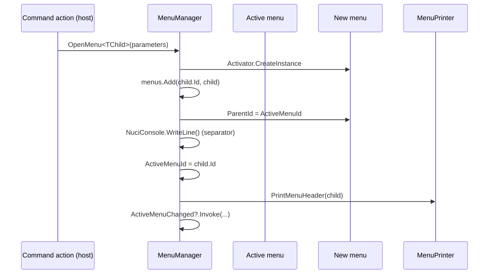
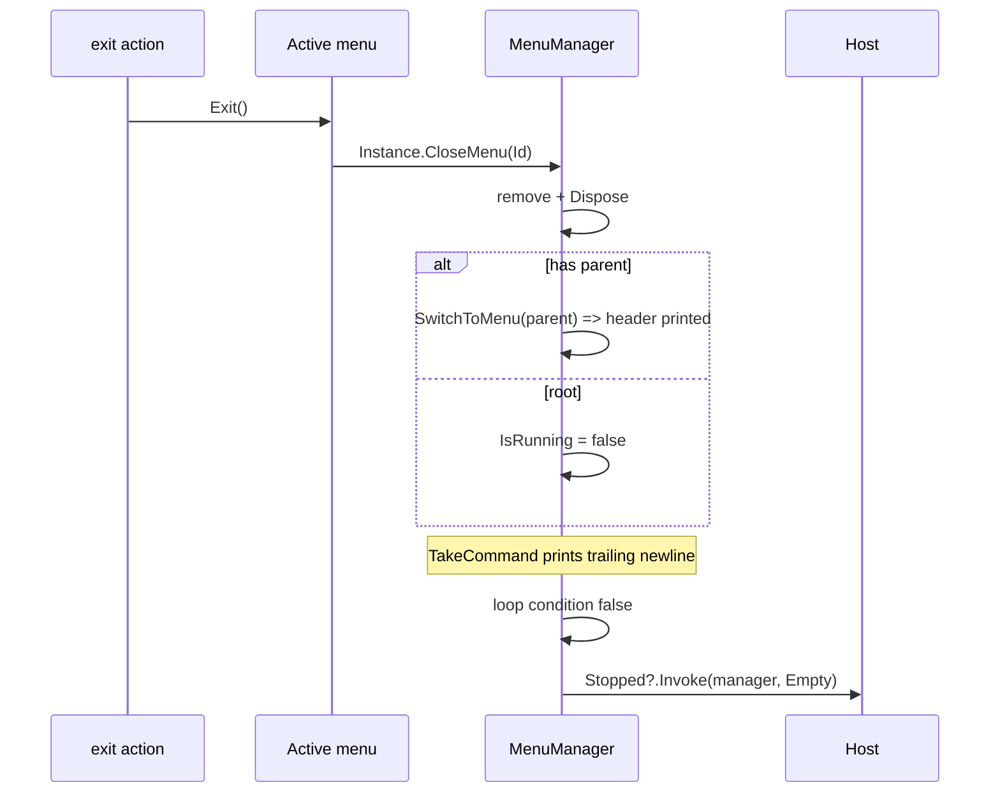

# Flow: menu navigation and shutdown

Source: `MenuManager.OpenMenu`, `CloseMenu`, `SwitchToMenu`, `Menu.Exit`.

## Opening a child menu



Key facts:

- `ParentId` is assigned **after** the child is constructed, so a child cannot read its parent during construction.
- The separator blank line is printed only when a menu was already active.
- The parent's instance stays in the registry and remains undisposed; returning to it does not re-run its constructor, so its commands and captured state survive.
- Re-opening the same type always creates a **new** instance with a new `Guid` identifier; there is no caching or instance reuse.

## Closing a menu

```
menu = menus[menuId]            // KeyNotFoundException if unknown
parentId = menu.ParentId
menus.Remove(menuId)
menu.Dispose()                  // clears commands, raises Disposed
if (parentId is non-empty) SwitchToMenu(parentId)
else IsRunning = false
```

| Closing target | Result |
|----------------|--------|
| Child menu | Removed and disposed; parent becomes active; parent header reprinted; `ActiveMenuChanged` raised |
| Root menu (no parent) | Removed and disposed; `IsRunning = false`; **no** header printed; `ActiveMenuChanged` **not** raised |
| Unknown id | `KeyNotFoundException`; nothing changes |
| `null` id | `ArgumentNullException` (from `Dictionary` indexer) |
| Id of a menu that is not the active one | That menu is closed anyway; the active menu is switched to the closed menu's parent, silently jumping levels |

`CloseMenu()` (no argument) closes the active menu and throws `ArgumentNullException` when `ActiveMenuId` is null.

## Switching menus

`SwitchToMenu(menuId)`:

1. Returns immediately when `menuId.Equals(ActiveMenuId)` — using `string.Equals` on the argument, so a `null` argument throws `NullReferenceException`.
2. Sets `ActiveMenuId`.
3. Prints the target menu's header.
4. Raises `ActiveMenuChanged`.

`SwitchToMenu` does not validate that the id exists before assigning it; a nonexistent id throws `KeyNotFoundException` from the `ActiveMenu` lookup inside `PrintMenuHeader`, leaving `ActiveMenuId` set to the invalid value. The manager is then unusable until another valid switch occurs.

## Shutdown



Shutdown characteristics:

- `Stopped` is raised only after the loop exits normally. Any exception escaping `TakeCommand` skips it.
- Disposal of the root menu happens before `Stopped`.
- `IsRunning` and `ActiveMenuId` keep their final values after `Start` returns; the manager does not reset to an idle baseline. A later `Start` on the same instance begins with `ActiveMenuId` still pointing at a disposed, removed menu, and `OpenMenu` will then treat the previous active id as a parent and print a separator line. The registry no longer contains that id, so the subsequent `SwitchToMenu` succeeds for the new menu but the stale `ParentId` points at a missing menu — closing the new menu then throws `KeyNotFoundException`.
- `MenuManager.Instance` is therefore effectively single-run per process unless callers manage state manually.

## Unreachable-but-possible transitions

| Transition | Reachability |
|------------|--------------|
| Close a non-active menu | Possible via `CloseMenu(id)`; documented risk above |
| `SwitchToMenu` to an unregistered id | Possible; corrupts active state |
| Opening a menu while `IsRunning` is false | Possible; registry grows without a loop |
| `Start` twice | Possible; see shutdown notes |