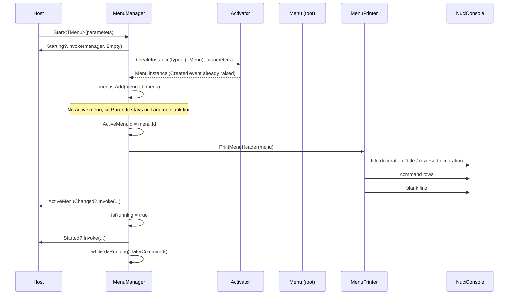

# Flow: startup and menu opening

Source: `MenuManager.Start<TMenu>` → `OpenMenu` → `SwitchToMenu` → `MenuPrinter.PrintMenuHeader`.

## Sequence

## Ordered effects (verified from source)

1. `Starting` is raised **before** any construction. A handler throwing here prevents all further work; `IsRunning` stays false, `ActiveMenuId` stays null, and `Started`/`Stopped`/`ActiveMenuChanged` are never raised (asserted by `MenuManagerLifecycleTests`).
2. The root menu's `Created` event has already fired inside its constructor, i.e. before `ParentId` assignment and before registration.
3. Because `ActiveMenuId` is null at this point, `string.IsNullOrWhiteSpace(ActiveMenuId)` is true and no separator line is printed.
4. `SwitchToMenu` cannot short-circuit for the root menu unless `ActiveMenuId` already equals the new id (possible only across repeated `Start` calls or after a manual `SwitchToMenu`).
5. `ActiveMenuChanged` is raised during `SwitchToMenu`, **before** `IsRunning` becomes true. A handler observing `IsRunning` during startup therefore sees `false`.
6. `IsRunning = true` precedes `Started`.
7. The loop starts after `Started` returns.

## Failure modes

| Failure point | Observable result |
|---------------|-------------------|
| Throwing `Starting` handler | Exception escapes `Start`; no menu constructed |
| Type has no matching constructor | `MissingMethodException` from `Activator`; nothing registered; `Started` not raised |
| `menuType` is not assignable to `Menu` | Invalid cast or activator exception; nothing registered |
| `menuType` is `null` | `NullReferenceException` |
| `Menu` constructor throws | Original exception escapes (`TargetInvocationException` is not produced by `Activator.CreateInstance` for constructor exceptions — the inner exception is rethrown) |
| `NuciConsole` write failure during header printing | Console exception escapes; menu already registered and active |

## Post-startup state

| State | Value |
|-------|-------|
| `menus` | one entry: root id → root instance |
| root `ParentId` | `null` |
| `ActiveMenuId` | root id |
| `IsRunning` | `true` |
| Console | title line, command rows, blank line |

## Starting a child menu directly

`MenuManager.OpenMenu<TChild>(...)` without `Start` performs steps 2–5 only: the menu is constructed, registered, given `ParentId`, a blank line is printed (because a menu is active), the header is printed, and `ActiveMenuChanged` fires. `IsRunning` remains unchanged. This is the path used when a command action opens a child menu, and it is why `IsRunning` is not reset between nested openings.

See [`command-dispatch.md`](./command-dispatch.md) and [`menu-navigation-and-shutdown.md`](./menu-navigation-and-shutdown.md).